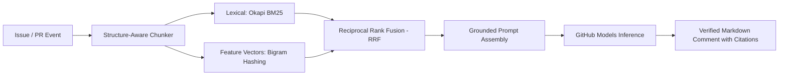

# ⚡ Hybrid RAG GitHub Action

[](https://github.com/marketplace/actions/hybrid-rag-assistant)
[](LICENSE)
[](package.json)
[](test/)

A production-grade, context-grounded GitHub Action that automatically answers repository **Issues** and **Pull Requests** using a **Hybrid RAG (Okapi BM25 + Deterministic Feature-Vector Retrieval + Reciprocal Rank Fusion)** architecture backed by **GitHub Models inference**.

---

## 🏛️ Architecture Overview



### 💎 Key Capabilities
* **Zero-Container Overhead:** Executes natively on Node.js 24 without container bootstrapping overhead.
* **Hybrid Search Engine:** Combines exact lexical term matching (Okapi BM25) with deterministic token/bigram feature-vector retrieval (Cosine Similarity).
* **Reciprocal Rank Fusion (RRF):** Merges multi-modal retrieval ranks deterministically using standard RRF: $RRF(d) = \sum_{m \in M} \frac{w_m}{k + r_m(d)}$.
* **Structure-Aware Chunking & Exact Citations:** Chunks Markdown by section headings while respecting code fences, mapping citations back to repository line ranges (`[path/file.md#L10-L35]`).
* **Prompt-Injection Defense Boundaries:** Delimits repository context and user inquiries within strict data boundaries to prevent instruction overriding.
* **GitHub Models Inference:** Uses the GitHub-provided token for inference; no external credentials required.
* **Observable Fallback:** Gracefully falls back to deterministic context analysis when GitHub Models inference is unavailable, reporting status as `fallback`.

---

## 🚀 Quickstart & Workflow Setup

Create a workflow file at `.github/workflows/hybrid-rag-assistant.yml`:

```yaml
name: 🤖 Hybrid RAG Repository Assistant

on:
  issues:
    types: [opened]
  issue_comment:
    types: [created]
  pull_request:
    types: [opened]

permissions:
  contents: read
  issues: write
  pull-requests: write
  models: read

jobs:
  assist:
    runs-on: ubuntu-latest
    steps:
      - name: 📥 Checkout Repository Context
        uses: actions/checkout@v4

      - name: ⚡ Run Hybrid RAG Assistant
        uses: Cagrik34/hybrid-rag-action@v1
        with:
          github-token: ${{ secrets.GITHUB_TOKEN }}
          docs-path: 'docs,README.md,CONTRIBUTING.md'
          query-trigger: 'auto'
          model-name: 'Phi-4'
```

---

## ⚙️ Inputs Configuration

| Input | Description | Required | Default |
| :--- | :--- | :---: | :---: |
| `github-token` | GitHub token used for GitHub Models inference and for posting responses to Issues and Pull Requests. Requires `contents:read`, `issues:write`, `pull-requests:write`, and `models:read` permissions. | **Yes** | `${{ github.token }}` |
| `docs-path` | Comma-separated file or directory paths to index recursively. | No | `README.md,action.yml,docs,CONTRIBUTING.md` |
| `query-trigger` | Trigger keyword (`auto` to answer all opened issues/PRs, or e.g. `@assistant`). | No | `auto` |
| `model-name` | GitHub Models model identifier (e.g. `Phi-4`, `gpt-4o-mini`). | No | `Phi-4` |
| `top-k` | Number of top fused passages to provide in LLM prompt context (1–100; constrained to a 32,000-character context budget). | No | `5` |
| `rrf-k` | Reciprocal Rank Fusion smoothing constant (1–1000). | No | `60` |

### 📤 Outputs

| Output | Description |
| :--- | :--- |
| `retrieved-chunks-count` | Number of relevant chunks retrieved and fused. |
| `response-status` | Execution status: `success` (GitHub Models inference succeeded), `fallback` (deterministic context fallback), `skipped` (unsupported event or missing trigger), or `failed` (unrecoverable error). |

---

## 🧪 Local Verification & Tests

Run the test suite locally with Node.js built-in test runner:

```bash
npm test
```

---

## 🛡️ CI & Automation Guarantees

* **Read-Only CI Permissions:** Workflow jobs default strictly to `contents: read`.
* **Automated Dependency Auditing:** Dependabot checks weekly updates for `npm` and `github-actions`, grouping minor and patch updates separately.
* **Enforced Dist Synchronization:** CI rebuilds the bundle via `@vercel/ncc` and verifies `git diff --exit-code dist/`. If any dependency or source update alters the bundle without a committed dist update, CI deterministically fails.

---

## 🌐 Tier-2 AI Framework Integrations

`hybrid-rag-action` includes modular Python reference implementations in [`ecosystem/`](./ecosystem):

| Framework | Module | Capabilities |
| :--- | :--- | :--- |
| **LangChain** | `ecosystem.langchain` | `BaseRetriever` + tool using BM25 + Feature-Vector RRF |
| **LlamaIndex** | `ecosystem.llamaindex` | Custom retriever for automated triage workflows |
| **Dify.ai** | `ecosystem.dify` | Tool provider plugin implementation for visual RAG |
| **Deepset Haystack** | `ecosystem.haystack` | Haystack 2.0 component with line citation fusion |
| **Stanford DSPy** | `ecosystem.dspy` | Declarative RAG module with assertion verification |

---

## 📄 License

Released under the [MIT License](LICENSE). Built by [Çağrı Giray Keşan](https://github.com/Cagrik34).
